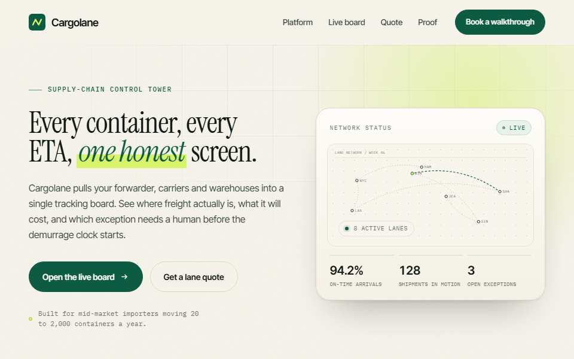

# Cargolane

**A supply-chain marketing site where the shipment board and the quote builder are real, not screenshots.**

[Live demo](https://supply-chain-022119993805548648404.vercel.app) | HTML, CSS and JavaScript, no build step



An editorial freight-forwarding site with a filterable shipment board, an instant quote builder, and
a contact form that validates before it sends. All copy and demo data live in one content file, so
the client can change the words without touching the components.

## What it does

- **An editorial hero** with a lane-network panel, so the network reads as a system rather than a
  stock photo.
- **A shipment board.** Eight seeded shipments with milestone trails, filterable by lane and status,
  with escalation when a milestone is late.
- **An instant quote builder.** Distance-based pricing with transit and CO2 estimates, computed from
  the lane the visitor picks.
- **The rest of a marketing site**: how it works, a section that explains the plain-file content
  model, case studies, integrations, and a validated contact form.
- **One content file.** Headlines, copy, shipments, rates and case studies all live in `content.js`.

## Run it locally

```bash
node dev-server.mjs
```

Open <http://127.0.0.1:5178>. Nothing to install.

## Verify

```bash
node check.mjs
```

Checks required sections, local assets, JavaScript parsing, the quote calculations and the static
routes over HTTP.

## How it is built

| Path | Purpose |
|---|---|
| `index.html` | The whole site: hero, board, quote builder, proof sections, contact |
| `content.js` | Every headline, shipment, rate and case study |
| `quote.mjs` | Distance, transit and CO2 calculations |
| `styles.css` | The visual system |
| `app.js` | Rendering, filters, quote form and contact validation |
| `vercel.json` | Static routing |

## What is simulated

Sample shipments, rates and case studies only. There is no carrier API, authentication, payment or
database. The contact form validates and confirms client-side; nothing is sent.

## About this prototype

Built as a working prototype for a real brief, then published as part of a portfolio. The interesting
part is the shape: a marketing site whose interactive pieces call the same pricing functions a real
integration would, with the copy separated into a file a non-developer can edit.
